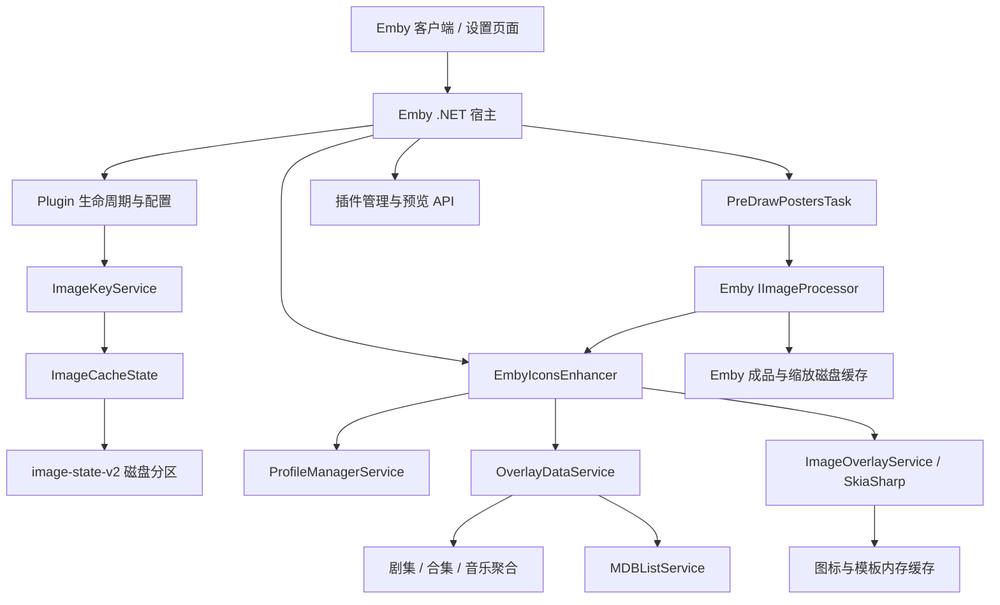
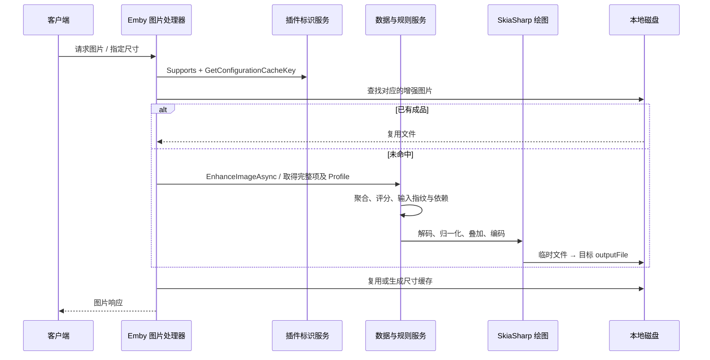

# 01 当前架构、调用链与功能实现

基线与证据范围见 [文档入口](README.md)。本文件描述当前 C# 实现；Rust 目标另见 [02 设计](02-rust-target-design.md)。

本文件保留源码完整功能清单，不代表本轮全部迁移。当前 Emby 的启用功能及裁剪范围见 [05](05-current-usage-and-scope.md)。

下文“本轮未查询”的表述指最初源码分析时点；后续已经完成的生产只读核查以 05 的记录为准。

## 1. 运行边界



当前项目没有 Rust 生产模块，也没有插件自建的独立图片 HTTP 服务。图片命名、是否命中成品以及面向客户端的尺寸转换属于 Emby 宿主的职责。

## 2. 模块与职责

| 模块 | 当前职责 | 主要源码 |
| --- | --- | --- |
| 插件入口 | 初始化、配置迁移、资源页面注册、库事件、用户数据事件、释放 | [Plugin](https://github.com/NevermoreN/EmbyIcons/blob/000ee767e29b7a39027689b15796d3ea52166463/Core/Plugin.cs)、[启动入口](https://github.com/NevermoreN/EmbyIcons/blob/000ee767e29b7a39027689b15796d3ea52166463/Core/ImageCacheEntryPoint.cs) |
| 图片增强接口 | 支持判断、配置缓存标识、真实制图、失败处理、并发限流 | [EmbyIconsEnhancer](https://github.com/NevermoreN/EmbyIcons/blob/000ee767e29b7a39027689b15796d3ea52166463/Core/EmbyIconsEnhancer.cs) |
| 配置与 Profile | 全局参数、单 Profile 参数、媒体库映射、路径匹配、合集 Profile 解析 | [PluginOptions](../Configuration/PluginOptions.cs)、[ProfileManagerService](https://github.com/NevermoreN/EmbyIcons/blob/000ee767e29b7a39027689b15796d3ea52166463/Services/ProfileManagerService.cs)、[Trie](https://github.com/NevermoreN/EmbyIcons/blob/000ee767e29b7a39027689b15796d3ea52166463/Helpers/Trie.cs) |
| 缓存标识 | 预计算配置快照、沿用绑定 Token、首次 Profile 解析兼容、评分周期 | [ImageKeyService](https://github.com/NevermoreN/EmbyIcons/blob/000ee767e29b7a39027689b15796d3ea52166463/Services/ImageKeyService.cs)、[RenderSettingsKey](https://github.com/NevermoreN/EmbyIcons/blob/000ee767e29b7a39027689b15796d3ea52166463/Helpers/RenderSettingsKey.cs) |
| 输入状态 | 输入投影、依赖关系、后台核验、分区加载和保存、局部分区恢复 | [ImageCacheState](https://github.com/NevermoreN/EmbyIcons/blob/000ee767e29b7a39027689b15796d3ea52166463/Caching/ImageCacheState.cs)、[ImageInputProjection](https://github.com/NevermoreN/EmbyIcons/blob/000ee767e29b7a39027689b15796d3ea52166463/Helpers/ImageInputProjection.cs) |
| 依赖与媒体识别 | 媒体流、子项、版本关系、标签、语言、编解码器等输入 | [ImageDependencies](https://github.com/NevermoreN/EmbyIcons/blob/000ee767e29b7a39027689b15796d3ea52166463/Helpers/ImageDependencies.cs)、[MediaStreamHelper](https://github.com/NevermoreN/EmbyIcons/blob/000ee767e29b7a39027689b15796d3ea52166463/Helpers/MediaStreamHelper.cs)、[MovieVersions](https://github.com/NevermoreN/EmbyIcons/blob/000ee767e29b7a39027689b15796d3ea52166463/Helpers/MovieVersions.cs) |
| 叠加数据 | 从媒体项与规则得到绘图所需的 `OverlayData` | [OverlayDataService](https://github.com/NevermoreN/EmbyIcons/blob/000ee767e29b7a39027689b15796d3ea52166463/Services/OverlayDataService.cs)、[OverlayData](https://github.com/NevermoreN/EmbyIcons/blob/000ee767e29b7a39027689b15796d3ea52166463/Models/OverlayData.cs) |
| 聚合 | TV/季/合集公共属性，音乐语言及技术属性，Lite/full 规则 | [视频聚合](https://github.com/NevermoreN/EmbyIcons/blob/000ee767e29b7a39027689b15796d3ea52166463/Core/EmbyIconsEnhancer.SeriesAggregation.cs)、[音乐聚合](https://github.com/NevermoreN/EmbyIcons/blob/000ee767e29b7a39027689b15796d3ea52166463/Core/EmbyIconsEnhancer.MusicAggregation.cs) |
| 素材与布局 | 内置/自定义图标、字体、图标组、评分文字、四角布局、条带和安全区 | [IconCacheManager](https://github.com/NevermoreN/EmbyIcons/blob/000ee767e29b7a39027689b15796d3ea52166463/Caching/IconCacheManager.cs)、[IconTemplateCache](https://github.com/NevermoreN/EmbyIcons/blob/000ee767e29b7a39027689b15796d3ea52166463/Caching/IconTemplateCache.cs)、[ImageOverlayService](https://github.com/NevermoreN/EmbyIcons/blob/000ee767e29b7a39027689b15796d3ea52166463/Services/ImageOverlayService.cs)、[FontHelper](https://github.com/NevermoreN/EmbyIcons/blob/000ee767e29b7a39027689b15796d3ea52166463/Helpers/FontHelper.cs) |
| 磁盘摘要 | 聚合结果持久化、指纹核对、旧摘要版本兼容 | [SummaryDiskStore](https://github.com/NevermoreN/EmbyIcons/blob/000ee767e29b7a39027689b15796d3ea52166463/Caching/SummaryDiskStore.cs) |
| 外部评分 | MDBList 请求、并发合并、失败冷却、七天刷新周期、旧评分回退 | [MDBListService](https://github.com/NevermoreN/EmbyIcons/blob/000ee767e29b7a39027689b15796d3ea52166463/Services/MDBListService.cs) |
| 主动预绘 | 分页遍历配置覆盖的媒体，调用 Emby 图片处理器生成成品 | [PreDrawPostersTask](https://github.com/NevermoreN/EmbyIcons/blob/000ee767e29b7a39027689b15796d3ea52166463/Tasks/PreDrawPostersTask.cs)、[LibraryItemPager](https://github.com/NevermoreN/EmbyIcons/blob/000ee767e29b7a39027689b15796d3ea52166463/Helpers/LibraryItemPager.cs) |
| 管理功能 | 配置导入导出、图标统计、缺失排查、预览、缓存管理、内存信息 | [API 路由](../Api/ApiRoutes.cs)、`Services/*Service.cs` |
| 设置前端 | 页面加载、数据读取、Profile 编辑、事件、预览和扫描进度 | [主控制器](../EmbyIconsConfiguration.js)、[页面](../EmbyIconsConfiguration.html)、`Configuration/*.js`、`Configuration/*.html` |

构建目标为 `netstandard2.0`；当前测试项目为 `net8.0`，使用 xUnit、Moq 和 SkiaSharp 原生资产。生产依赖版本见 [项目文件](../EmbyIcons.csproj)，不是依据机器上的最新 SDK 版本推断。

## 3. 启动和关闭调用链

1. Emby 创建 `Plugin`，注入 `IApplicationHost`、`IApplicationPaths`、`ILibraryManager`、文件系统、日志及 XML 序列化器。
2. 构造函数创建 `ImageCacheState`，从 `data/EmbyIcons/image-state-v2` 读取既有分区；建立反向依赖和电影版本分组。
3. 创建初始 `ImageKeyService`，订阅媒体库、合集及用户数据事件；此时不能假定配置路径已经由宿主完整赋值。
4. `ImageCacheEntryPoint.Run → Plugin.InitializeImageCache`：读取配置、预计算配置/投影签名、检测 SkiaSharp、异步预热库路径、启动后台输入核验。
5. `ImageCacheState.Start` 针对已跟踪项与依赖启动核验，按最多 500 项批次取得媒体数据；这不是自动把全库图片绘制一遍。
6. 关闭时取消后台任务，取消事件订阅、停止定时器，保存脏分区及必要的摘要，释放内存和图形资源。

`Load` 是启动时读取持久状态；图片标识回调没有磁盘读操作，不代表整个启动过程没有磁盘 I/O。

## 4. 图片列表与标识链

```text
Emby 构造带图片信息的媒体 DTO
  → Emby 查询支持的 IImageEnhancer
  → EmbyIconsEnhancer.Supports
  → 缓存中的 Profile / 已绑定 Profile / 适用规则判断
  → GetConfigurationCacheKey
  → ImageKeyService.GetKey
  → ImageCacheState.WithBinding / ProjectionVersion
  → 返回插件标识 ei11_...
  → Emby 将原图信息与增强器标识组合为客户端图片 Tag
```

`Supports/GetConfigurationCacheKey` 的目标是只读已加载数据和内存状态，不查询子项、不读取媒体流、不请求外部评分。这里仍可能创建或更新内存绑定、标记分区为脏，不能称为完全无副作用的纯函数。

媒体列表可能携带部分字段，实际图片请求可能拿到完整实体。首次知道 Profile、重新学习依赖和缓存淘汰都不应仅因信息获取阶段不同而改变最终画面标识。

## 5. 当前图片请求与真实绘图链



真实绘图的当前顺序：

1. 取得全局并发锁，加载完整媒体项，解析实际 Profile，绑定 Profile。
2. 通过 `OverlayRequirements` 再确认是否应处理该媒体和图片类型。
3. 取得 `OverlayData`，读取必要依赖、计算依赖戳，调用 `ImageState.Observed(..., rendering: true)`。
4. 读取原图，按 `MaxRenderDimension` 选择解码尺寸；必要时归一化海报、横图、横幅或音乐方图比例。
5. `ImageOverlayService.ApplyOverlaysToStreamAsync` 加载图标，生成或复用模板，排列图标/文字/条带，应用安全区，按 JPEG/PNG/Auto 编码。
6. 写 `outputFile.<随机值>.tmp`，成功后替换或移动到 Emby 指定的 `outputFile`；异常时清理临时文件并释放资源。

值得核查的顺序问题：当前 `Observed(rendering: true)` 在原图解码、图像编码和原子落盘之前执行。它表示“观察到绘图输入”，不能直接作为“磁盘成品已成功生成”的可靠凭证。目标设计必须拆开这两种状态。

## 6. 预绘调用链与现状边界

```text
Emby 调度 PreDrawPostersTask.Execute
  → 解析有效 Profile 的媒体库范围
  → LibraryItemPager 以 500 项分页遍历
  → 限制并行度，WarmItemAsync
  → 检查 Primary / Thumb / Banner 的原图
  → IImageProcessor.GetSupportedEnhancers
  → IImageProcessor.ProcessImage
  → 命中 Emby 成品或执行同一条增强链
```

- 任务不自行发明最终成品文件名；复用宿主处理链，已有成品应被跳过。
- 当前 `GetDefaultTriggers()` 返回空集合；后续 05 的现场只读核查也确认实际任务 `Triggers=[]`。
- 支持范围包括 Movie、Series、Season、Episode、BoxSet、Video、MusicVideo、MusicAlbum、MusicArtist、Audio、Photo。
- 批量任务已经存在，**自动入库队列尚未接入**。新增/更新事件本身不等于执行了 `WarmItemAsync`。

## 7. 媒体变化、依赖及失效链

```text
ItemAdded / ItemUpdated / ItemRemoved
  → Plugin.HandleItemChanged 等处理器
  → 清理项/Profile/聚合的内存缓存
  → ImageCacheState.Changed：记录待核验项、父项与关联关系
  → 后台 Drain / Verify
  → ResolveProfile / ImageKeys.Bind
  → 比较轻量输入，必要时 InspectImageInputsAsync 检查重输入
  → Observed 比较实际输入指纹，更新相关版本并保存脏分区
```

合集成员事件、剧集移动的旧/新父项、多版本电影和音乐关系分别参与依赖处理；不是每个库事件都全局刷新。收藏相关用户数据变化与播放进度需区别处理，播放进度不应触发图片重画。

这一链主要核验“是否变化”，不是“把变化后的图片画好”。新任务必须把核验结果与后台预绘连接起来，并防止绘图引发的宿主事件反复入队。

## 8. 设置与辅助功能链

```text
EmbyIconsConfiguration.js
  → 加载 Configuration 页面模块和部分 HTML
  → ApiClient / 插件 API
  → 配置读取、编辑、预览、扫描、导入导出
  → Plugin.UpdateConfiguration / SaveCurrentConfiguration
  → SettingsChangeAnalyzer + RenderSettingsKey + ImageKeys.Configure
  → 按配置影响范围失效或沿用既有标识
```

| 功能链 | 主要入口 | 要保留的语义 |
| --- | --- | --- |
| Profile 管理 | `ProfileService`、`ProfileManagerService` | 库映射、目录边界、合集查找；Profile 改名不等于画面变化 |
| 导入导出 | `ProfileImportExportService`、`ProfileExportImportApiServices` | 冲突重命名/覆盖、空值修复、库映射验证、错误结果 |
| 预览 | `PreviewService` | 与正式绘图使用同一规则和布局；预览不污染媒体成品缓存 |
| 图标管理 | `IconManagerService`、`ItemsByIconService` | 扫描、缺失/找到/未使用图标、统计与分页进度 |
| 排障 | Series/Movie/Music Troubleshooter | 报告不满足公共图标条件的媒体差异 |
| 刷新缓存 | `CacheManagerService` | 显式改变 `PersistedVersion`；不能当作普通升级步骤 |
| 统计与资源 | MemoryUsage、TemplateCacheStats、ScanProgress、StaticImage、AspectRatio、Validation | 维持现有路由、管理员权限、取消和错误表达 |

完整路由清单以 [ApiRoutes.cs](../Api/ApiRoutes.cs) 为准，迁移时逐项登记，不能只覆盖主设置页。

## 9. 功能与规则清单

- 媒体输入：音频/字幕/原始语言、声道、视频/音频编码、HDR/Dolby Vision、分辨率、帧率、宽高比、分级、来源、标签、文件名规则、收藏数、评分、剧集状态、采样率、码率、位深。
- 聚合：视频公共属性与交集规则；音乐语言并集及技术属性规则；Lite/full、特别篇排除、合集与多版本电影处理。不同媒体不能统一改成一种聚合算法。
- 素材：BuiltInOnly/CustomOnly/Hybrid、自定义命名、内置资源、字体和素材内存复用。
- 图形：海报/Thumb/Banner、音乐方图、尺寸限制、四角位置与独立尺寸、优先级、横竖布局、间距、边距、安全区、上下图标条、评分背景及透明度、字体偏移、输出质量。
- 运行：异步取消、全局绘图并发、模板生成去重、临时文件清理、原图缺失及宿主错误处理。

## 10. 缓存与持久化实现

以下为已知 NAS 映射中的路径说明，不代表本轮重新统计过文件数量。

| 内容 | 内存职责 | 磁盘位置（配置目录相对路径） |
| --- | --- | --- |
| 增强成品 | 由宿主决定复用 | `cache/images/enhanced-images/` |
| 尺寸衍生图 | 由宿主决定复用 | `cache/images/resized-images/` |
| 稳定绑定与输入指纹 | `ImageCacheState` 工作集及反向索引 | `data/EmbyIcons/image-state-v2/` |
| 图标位图与模板 | `IconCacheManager`、`IconTemplateCache` 内存缓存 | 素材原文件/内置资源；不是另一套成品图片库 |
| Profile/项/聚合查询 | 有界内存缓存 | 部分聚合结果可写 `plugins/embyicons/summaries-*.json` |
| MDBList 评分 | 内存命中、请求合并、失败冷却 | 按配置启用 `plugins/embyicons/mdblist-ratings.json` |
| 配置 | 全局和 Profile 对象 | `plugins/configurations/embyicons.xml` |

配置根在既有部署中为 `/volume1/docker/emby/config`；插件应从宿主获取容器内路径，不把 NAS 宿主绝对路径写死在实现中。

`image-state-v2` 当前按 FNV 分为 1024 个分区。文件外层为 `Format=2 / Data=内层JSON字符串 / Checksum`，校验采用内层字符串 UTF-8 的 SHA-256 前 16 字节大写十六进制。保存使用临时文件与 `.bak`；损坏分区通过局部恢复标记处理。配置兼容、字节编码、GUID 表达和字段默认值都属于 Rust 迁移契约。

旧标识形态为 `ei11_...`，包括媒体身份、图片类型、绑定配置 Token、输入版本及适用时的评分版本。`RenderCompatibilityVersion="1"` 和 `summary-data-1` 表达不同兼容范围，不能随 DLL 版本机械递增。

## 11. 已证事实、疑点与未覆盖项

| 类型 | 结论 |
| --- | --- |
| 已证事实 | 当前成品由 Emby 原生磁盘缓存承载；插件已有稳定绑定与输入状态持久化 |
| 已证事实 | 入库事件没有直接调用预绘；请求未命中仍可执行真实绘图 |
| 实现风险 | 绘图观察记录早于文件成功提交；需要验证失败时状态和文件是否会脱节 |
| 未闭环观察 | 列表 Tag 与推测成品后缀不能逐一对应；尚未排除完整项差异、其他增强器、原图修订、评分周期等因素 |
| 验证不足 | 先前按同一原图前缀检查文件集合/修改时间，只证明样本重复请求与重启后的复用，不证明每个列表 Tag 与最终成品一一对应 |
| 不应下结论 | 不能把 4 个首次新缓存都认定为错误重画，也不能认定全部必要 |
| 最初分析时未做 | 当时未查询生产运行数据；后续只读核查见 05。文档工作始终未重跑项目测试、执行预绘或修改配置 |

## 12. 宿主资料

- [IImageEnhancer](https://dev.emby.media/reference/pluginapi/MediaBrowser.Controller.Providers.IImageEnhancer.html)：支持判断、配置缓存键和增强回调。
- [IImageProcessor](https://dev.emby.media/reference/pluginapi/MediaBrowser.Controller.Drawing.IImageProcessor.html)：宿主图片处理入口。
- [ILibraryManager](https://dev.emby.media/reference/pluginapi/MediaBrowser.Controller.Library.ILibraryManager.html)：库查询与库事件接口。

此前对当前部署所用 Emby 核心的定点分析支持“原图信息 + 增强器键 → 成品路径，文件存在则复用”的描述；具体哈希编码、处理顺序和失败分支仍需在 P0 固化为当前目标版本的可复现实测。宿主二进制不属于本仓库源码。
