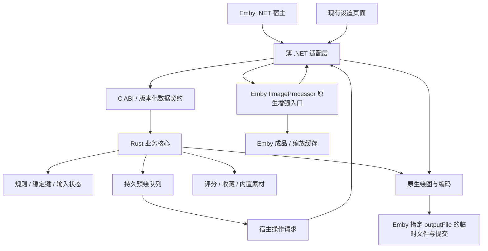
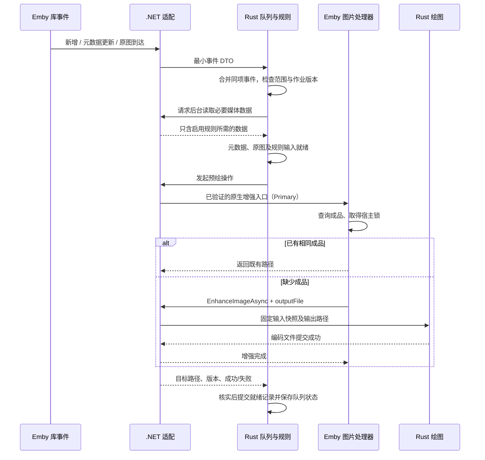

# 02 Rust 业务重构目标设计

本文是目标方案，不是当前已实现架构。现状见 [01](01-current-architecture.md)，任务依赖见 [03](03-execution-plan.md)。

本次只迁移 [05 当前使用情况与范围裁剪](05-current-usage-and-scope.md) 的保留项：电影/Series/适用合集的 Primary、六类叠加、内置素材、当前布局和 PNG。以下“业务迁移”均指这一范围；源码现有但当前未使用的技术图标、音乐、聚合等不再要求实现。

## 1. 职责边界

采用“Rust 业务核心 + 薄 .NET 宿主适配层”，不新增常驻独立 HTTP 服务，也不把现有 Emby 替换成另一个媒体服务器。

| 边界 | 最终职责 | 不应继续承担的业务 |
| --- | --- | --- |
| .NET 适配层 | 插件注册/释放、接收宿主事件、管理员鉴权、取得宿主配置与媒体 DTO、调用宿主图片处理器、暴露设置资源、转发日志/取消 | 图片标识算法、聚合规则、预绘优先级与重试、评分缓存策略、布局与像素绘制 |
| Rust 核心 | 保留范围内的 Profile 与规则、标识/依赖/状态、预绘队列、评分/收藏业务、内置素材、布局、解码/绘图/编码、管理业务 | 直接使用 .NET 对象或绕过 Emby 修改其数据库 |
| Emby 宿主 | 数据库、权限身份、原图定位、增强器组合、最终成品路径、宿主文件锁、缩放缓存及 HTTP 图片响应 | 不假定可随意修改宿主二进制 |
| 设置前端 | 继续提供现有 HTML/JavaScript 交互，通过现有插件 API 访问 Rust 业务 | 不为“全 Rust”额外重写成 WASM 页面 |

保留范围内的业务最终迁移到 Rust，不以“只有分区解析换 Rust”作为完成标准。分阶段保留 C# 是为了迁移验证；最终适配层仍需保留真实宿主接口调用，不能伪称整个插件已没有 .NET。旧配置中未支持字段必须保留，界面禁止静默启用未实现的功能。

## 2. 目标调用关系



队列策略只有 Rust 一个所有者。.NET 可以执行机械的数据查询、异步调用和完成通知，不能再保留第二套业务重试队列。正常图片请求不创建绘图任务；入库、更新、定时修复或管理员预绘操作负责触发后台任务。

## 3. 拟定代码组织

```text
native/embyicons-core/          # 一个 Rust crate，输出 cdylib；不是多个微服务
  Cargo.toml
  src/
    lib.rs                     # ABI 入口、句柄、错误映射
    contract.rs                # 宿主 DTO 与版本契约
    profile.rs                 # Profile、路径、导入导出
    rules.rs                   # 保留媒体输入与六类叠加的适用规则
    cache.rs                   # 绑定、标识、依赖、分区读写
    predraw.rs                 # 入库预绘、去重、恢复、并发
    ratings.rs                 # 外部评分与刷新
    render.rs                  # 布局、图标、图像编解码
    management.rs              # 预览、扫描、排障、统计
  tests/                       # 与 C# 黄金样本对照
Interop/                       # 拟新增 .NET ABI 包装及句柄管理
Host/                          # 宿主生命周期/增强器适配
Configuration/                 # 保留兼容 DTO 与前端资源
tools/HostCacheProbe/          # Rust 后端的宿主缓存契约工具
```

这是初始组织建议。实现时按真正的职责拆文件，不为凑目录建立转发层。迁移完成的旧 C# 业务逐段删除；没有迁移完的阶段不能声称全面重构已经完成。

## 4. Emby 原生缓存的协作原则

### 4.1 只有宿主决定最终图片路径

后台预绘必须通过 `IImageProcessor` 的原生增强入口，使宿主按自身规则组合原图和全部增强器的标识、取得锁、判断是否已有成品，再调用我们的增强器。现有路径为 `ProcessImage`，候选 `GetEnhancedImage` 的取舍见 4.3。Rust 只写本次宿主传入的 `outputFile`，不猜测并抢写最终成品名称。

增强文件保持在 `cache/images/enhanced-images`，尺寸衍生文件保持在 `cache/images/resized-images`。不增加另一套按电影名称保存的“主成品目录”，不覆盖媒体原始海报。

原图始终只读。绘图开始前检查实际原图路径与目标路径不同，只在宿主给定的增强缓存目标旁创建临时文件并原子提交；完成登记再次拒绝原图路径。校验使用原始 `ItemImageInfo` 对应的来源，而非多增强器链中可能已经等于输出路径的中间输入。不得将成品写回媒体目录的 `poster.*`、元数据原海报或原图路径，也不得在清理缓存时删除这些原图。

### 4.2 必须区分四个不同概念

| 概念 | 含义 | 什么时候产生 |
| --- | --- | --- |
| 期望画面版本 | 当前配置与相关媒体输入应产生什么画面 | 事件或后台核验确认输入后 |
| 插件缓存键 | Rust 向 Emby 返回的稳定增强器键 | 输入快照已确定后；热回调只查内存 |
| 宿主成品标识/路径 | 原图信息、其他增强器、插件键组合的结果 | 由 Emby 图片处理器生成 |
| 已提交就绪记录 | 此版本对应的成品已成功落盘并被核实 | 成功提交后；不能在开始绘图时提前标记 |

不能把“某个分区存在”“输入核验通过”“HTTP 返回 200”当作成品已经存在的证据。

后台为期望版本准备宿主增强调用所需的键，直到该次操作完成都固定使用这一键及输入快照；普通浏览对该版本的可用性、列表 Tag 与新旧尺寸缓存切换必须在 P0 一起确认。不能等绘图成功后才临时算出另一把键，也不能把“已返回目标键”误当作“已经就绪”。

P0 原型已验证：后台上下文使用冻结目标键，普通回调只读已发布记录；尚未就绪时不参与增强。成品缺失后，普通请求只返回原图且不排队、不制图，后台维护独立补齐。当前 Emby 图片服务对带 Tag 的回退仍设置一年缓存策略，因此此项恢复允许递增本媒体的恢复后缀，在补图成功后发布新 Tag；否则浏览器可能继续复用旧原图。该例外不扩散到其他媒体，也不在每次缺图请求中重复递增。证据与尚未实现的边界见 07。

### 4.3 优先核查直接取得增强成品的入口

在原定 P0 宿主核查中确认当前版本 `GetEnhancedImage(item, Primary, 0, cancellationToken)` 的行为。若它能完整经过同一增强器组合、稳定标识、锁和磁盘缓存，并满足请求隔离与失败语义，则优先用于后台取得准确增强成品路径，避免不需要的缩放/转码处理。

若上述条件不成立，继续使用已验证的 `ProcessImage` 路径；不能绕过宿主或自己计算成品文件名。每次作业只走选定的一个入口，不为比较两种入口重复生成同一张图。接口存在不代表在当前宿主中已经证明更快，结论复用既有主流程证据。

## 5. 稳定标识与差异修复

### 5.1 需要守住的规则

- 媒体身份以宿主稳定 ID、媒体种类和图片类型为基础；没有外部提供商 ID 也必须正常工作。
- 重启、DLL 版本、语言迁移、缓存容量、日志开关、Profile 改名和首次学到完整 Profile，不应独立改变画面键。
- 只纳入该媒体、该图片类型真正使用的规则、素材、数据和依赖；关闭的图标、其他 Profile 和无关子项不应影响本图。
- 原图内容/修订、启用的图标资产、启用规则相关的媒体输入、真正变动的评分或显式手动刷新可以使相关画面失效。
- 内置素材修订应按实际画面影响管理；本轮不做当前未使用的自定义素材目录和原地替换监听。
- 新版本图片在准备阶段不能反复改变键；预绘、绘图回调和普通请求必须共享同一个不可变输入快照/作业版本。
- 原图、其他增强器和宿主算法变化可能合法地改变宿主成品标识，不能为了表面“零重画”隐藏这些变化。

### 5.2 先诊断，再改算法

P0 使用同一批媒体、同一图片类型，记录：部分项/完整项身份、Profile 解析结果、原图修订、插件键、全部增强器组合后的宿主 Tag、实际 `outputFile`、提交前后键、输入版本与生成原因。采用脱敏 ID 和摘要，不记录 API 密钥或完整配置。

归因至少区分：部分实体差异、Profile 学习、评分周期、真实元数据变动、原图更新、其他插件、失败后错误发布就绪、兼容签名变化、宿主自身缓存清理。只有证据指向的路径才改；不能靠清缓存验证“修好了”。

### 5.3 兼容契约

首先实现旧 `ei11`、绑定 Token、`DataBaseline/DataAlias`、`image-state-v2` 和摘要指纹的兼容读与等价计算。黄金样本应覆盖 GUID 字节序/字符串、哈希大小写与截断、原始字符串编码、JSON 属性顺序、浮点与时间表示、Unicode 及路径大小写规则。

现有 `ImageInputProjection.Hash` 是 UTF-8 SHA-256 前 16 字节大写十六进制；旧渲染 Token 和 Emby 宿主哈希不是同一算法。不得把它们一律替换为 Rust 默认哈希。Emby 宿主哈希的编码和 GUID 表达以 P0 核查的目标版本为准。

“修复漂移”和“更换渲染效果”分别管理兼容版本。只有效果或数据计算确实不兼容时才升级相应兼容版本，不能让 ABI/安装包版本自动使全库图片失效。

### 5.4 评分刷新

将“到了检查评分的时间”和“新画面已经就绪”分开。Rust 后台到期获取评分；值未变或获取失败继续沿用已确认画面和旧值，真实变化才调度新版本预绘。旧版本基于七天区间的字段通过兼容绑定迁移，不能在图片请求时仅因时钟跨区间就触发新图制作。

首次入库不能无限等待可选评分。原图可读、Profile 和必要本地输入可用后，外部评分按已有缓存/一次有超时的合并请求处理；缺提供商 ID、404 或该来源无评分是正常缺值，按现有规则省略相应叠加。网络失败有旧值则复用，无旧值则按缺值制图并保留有限后台刷新；以后真实评分到达再定向更新，不把失败或缺值当作已获取到新分数。

## 6. 入库主动预绘

### 6.1 正常流程



入库事件回调只交付事件，不等待磁盘、评分、媒体流检查或绘图。使用后台短暂合并窗口消化一次刮削的多次通知；只有新事件或有限重试才唤醒未就绪项，不以用户请求唤醒绘图。

### 6.2 队列状态及语义

采用足以恢复作业的状态，不引入通用工作流平台：

| 状态 | 说明 | 后续动作 |
| --- | --- | --- |
| 等待输入 | 原图或规则必需的媒体字段尚未到达 | 等待库更新/后台有限重试 |
| 待执行 | 已得到期望版本并合并重复事件 | 按限流与优先级调度 |
| 执行中 | 已取得任务版本，宿主正在预绘 | 更新事件只登记下一版本，不并发绘同图 |
| 已就绪 | 对应文件已经提交并核实 | 普通请求复用；相关变化再入队 |
| 失败待重试 | 暂时性 I/O/网络等失败 | 有限退避并暴露原因；不永久占用并发槽 |
| 需人工处理 | 永久输入错误或达到重试上限 | 管理界面可见；新输入/显式重试可恢复 |

去重至少按媒体身份和图片类型，作业携带配置/输入生成号。旧作业完成时若输入已更新，不得把旧结果发布为新版本已就绪；中间原图临时文件需要清理，但不删除已有正确成品。

只读快照、运行中作业和待办分别管理。调用 Emby 或等待网络/I/O 前释放 Rust 状态/队列锁，因为宿主会同步或异步回调支持判断、键查询及增强接口；不能持同一把锁跨这些调用。返回后再按生成号短暂加锁提交结果。Rust 只提交本次增强器输出；宿主还有后续增强器时，必须等整个宿主操作成功并确认最终路径，才登记成品就绪。

重启恢复“未完成作业”而非从零全库重画；执行中作业先核对已存在成品。首次接入既有媒体库需要一次有界分页补齐，把事件接收先启动再扫描，避免扫描期间新入库遗漏。

队列内存与扫描在途数有上限，重复通知只合并媒体 ID/生成号。扫描生产者遵守背压；宿主事件回调不等待绘图，合并待办按批持久化。尚未持久化即崩溃的窗口由重启时有界分页对账补回，不能声称仅靠定时保存就绝不丢事件。正常关闭先停入口并排空/保存待办，再等待宿主调用退出，最后释放原生句柄。

事件超过内存容量时合并为相应映射库“需要对账”的标记，后台分页恢复具体项，不无限保留每次事件或静默丢弃更新。此对账只检查范围和输入/成品，不能变成无条件全库重画。

### 6.3 触发覆盖

| 触发 | 需要调度的范围 |
| --- | --- |
| 新电影/Series | 已映射 Profile 下适用的 Primary |
| 元数据刷新 | 后台核验评分、分级、原图等实际画面输入；有变化才重绘，无变化复用 |
| 新集、季 | 仅核查保留范围中真正受影响的 Series/合集依赖；不绘单集/季 |
| 合集成员、多版本电影变化 | 新旧关联中受影响的画面 |
| 原图到达/替换、内置素材修订 | 使用该输入的保留范围画面 |
| Profile 视觉规则变化 | 该 Profile 实际覆盖的适用图片 |
| 日志/缓存容量/Profile 名称变化 | 不调度重新制图 |
| 外部评分真实变化、收藏数变化 | 启用相应评分/收藏图标的画面 |
| 媒体删除或移库 | 取消待办，更新旧/新依赖；不删除媒体原图或全局图片缓存 |
| 显式 Pre-draw / 定向重试 | 复用同一队列，不产生第二套并发作业 |
| 磁盘成品被宿主清理 | 后台对账发现后入队补齐 |

扫描/原图下载/元数据完成的具体事件能力必须在 P0 核对，不能凭空添加不存在的“元数据全部就绪”宿主 API。

### 6.4 手动计划任务与保存完成

沿用现有 `EmbyIconsPreDrawPosters` Key 和 Emby 计划任务入口，管理员可以手动启动或配置宿主触发器。按映射库分页选择适用的 Primary，提交同一个 Rust 队列；自动事件与手动作业重叠时去重，不重复绘制。

任务必须等目标作业得到可核实的结果才结束，不能入队即报告成功。进度分别统计实际绘制、有效成品复用、无适用原图/规则跳过和失败；尚在等待输入的作业不能伪装成已绘制。取消停止本次扫描/等待，并撤销仅属于本次任务的未开始工作，不误取消自动事件同样需要的作业。成品经选定的宿主原生增强入口保存到 Emby 磁盘缓存，HTTP 200 或回到原图不算制图成功。默认复用有效成品，本轮不额外增加强制全库重画模式。

本次人工任务采用固定扫描范围与所提交的目标生成号，不追逐任务启动后的所有新事件。范围内每项最终归入绘制、复用、跳过/延期或失败；缺原图和可重试输入只做有限等待，仍未就绪则记为延期并留给自动队列，新一轮更新不使人工任务永久无法结束。延期/失败单独报告，不能计为已保存。目标在运行中被更新时，已被新版本取代的目标不再无限等待，继续由自动队列处理最新版本。

### 6.5 限定查询范围与分别控制网络、绘图并发

自动任务、人工任务和历史补齐都只制作 `Primary` 海报。分页查询时就限定映射库及 Movie/Series；BoxSet 单独按现有成员/Profile 规则判断。不要先枚举全部 Episode/Season 再逐项跳过，也不遍历 Thumb/Banner 等图片类型。关联事件只做保留功能需要的定向失效，旧分区兼容数据不得因此丢弃或批量换键。

库 ID/映射解析失败时跳过该范围并明确报告，不能沿用旧任务“解析失败就检查所有库”的回退。合集尚未证明有 B Profile 实例，保留适用性逻辑，但不把全库合集数量当作实际绘图数量。

入库、刷新和手动任务共享同一队列、输入指纹与生成号，同一媒体同一画面只制作一次。MDBList 网络请求与 CPU 绘图分别限流：网络等待、退避和等待输入期间不持有绘图槽，得到可用数据快照后才开始绘图。优先复用已有评分缓存和同一评分请求，保留当前限流/过期语义，不先建设复杂流水线或第二套调度器。

## 7. 用户访问不触发制图的严格要求

这是独立于“有入库队列”的验收项，不能用“通常已预绘”代替。

目标策略：已就绪则让 Emby 复用磁盘成品；未就绪则先正常返回原图，后台作业继续完成。暂时出现原图是队列未完成的表现，不应偷偷转为请求线程即时绘图。若未来要在入库系统中延迟“对用户可见”，需另行确认宿主能力，不假定插件能控制库条目的可见性。

必须处理三个宿主边界：

1. 后台预绘必须能调用增强器；普通请求在未就绪时不能启动增强绘图。拟通过适配层的操作上下文区分主动预绘与普通图片回调，具体机制先验证。
2. 绘图中/失败时不能把原图复制到最终增强键路径，也不能使对应尺寸缓存把原图误认为最终增强成品。
3. 就绪标记与磁盘文件可能因宿主清缓存而短暂失配。请求路径发现缺图后不能自行重画，应返回可用原图并由后台补齐；拒绝增强时宿主如何处理文件和缩放缓存，必须实测。

补图不能只有一个“就绪”布尔值。就绪记录至少关联已确认的作业版本和准确宿主路径，由统一后台维护循环按有界批次核查已有记录，缺失才重新排队；启动恢复与手动任务复用同一核查逻辑。周期采用现有维护设置，记录扫描游标，避免每次遍历全部磁盘或为每张图创建定时器。请求不负责调度这一修复，标识热回调仍不做磁盘检查；原图回退与列表 Tag 的最终一致性仍由 P0 证明。

宿主清缓存后的自动补图存在维护周期和队列等待延迟；不能同时承诺“请求不触发补画”与“缺图立即恢复”。人工任务可以主动核查缺口，但不改变普通请求策略。

`Supports=false`、异常回退或上下文标记都不能未经验证就被宣布为完整解法。P0 必须证明列表标识、后台预绘标识、请求支持判断、宿主落盘以及失败/缺图行为兼容。如果公开接口不能同时满足这些条件，则先明确最小宿主适配需求和限制；不得悄悄恢复惰性绘图，也不得擅自修改 Emby 二进制。

## 8. 跨语言接口

- Rust 输出 `cdylib`，以版本化 C ABI 暴露创建、配置、批量事件、键查询、后台工作领取/完成、管理操作、关闭与释放能力。函数名和 DTO 在 P1 固化，本文不把拟定接口当作现有 API。
- .NET 目标仍先维持 `netstandard2.0`，使用兼容的 P/Invoke 声明，不直接照搬要求 .NET 7+ 源生成器的接口。
- 不把 `BaseItem`、托管对象指针、托管 `Task`、委托闭包或 Rust `Future` 直接跨边界传递。
- 高频键查询使用媒体 ID/类型/图片类型及已加载状态；避免每个列表项都 JSON 序列化完整媒体/配置或重复跨边界取一个字段。
- 配置更新、事件和媒体取数采用明确、可批量的数据契约。图像使用宿主给定的文件路径或受控缓冲区，不反复拷贝整幅位图跨语言边界。
- Rust 句柄与返回缓冲区由匹配的 Rust 释放函数销毁，.NET 用明确的生命周期包装；约定 UTF-8、整数宽度、可空字段、长度和取消语义。
- Rust 可恢复错误转换为错误码/错误详情；不能让 panic 或 .NET 异常跨 ABI 展开。捕获 panic 不是对任意原生内存错误的安全承诺。
- ABI 加载失败或版本不匹配时记录明确错误，保持服务器可用且不误写缓存；严格预绘模式下不能自动退回“用户访问时用 C# 绘图”。

异步操作通过作业句柄/完成通知协调，由适配层调用现有 .NET 异步 API。是否需要 Rust 异步运行时在 P1 根据评分 HTTP、取消和作业生命周期确定，不为使用某个库先引入第二套业务调度系统。

热查询先用一次简单的固定结构 ABI 调用完成，配置和事件采用必要的批量传输。整张海报只在原生绘图端解码、绘制和编码，跨语言传宿主路径，不把像素来回复制。默认不加 .NET/Rust 双端键缓存；只有既有计时证明 ABI 热查询确为瓶颈时，再考虑 Rust 发布只读结果快照，不能引入第二套键算法或业务状态所有者。

## 9. 保留范围内的渲染、规则和管理迁移

1. 从现有配置和 `OverlayData` 定义建立可版本化输入模型，按媒体类别保留规则差异。
2. Profile 匹配、导入导出、六类叠加、内置图标命名与变体选择移到 Rust，并逐项对照旧实现；不迁移已移除的技术/音乐聚合。
3. 原生渲染优先评估 Rust 调用 Skia，尽量保持既有字体、色彩、抗锯齿、布局与编码行为。先核对 SkiaSharp 所用原生 Skia 与候选 Rust 绑定的版本，不能假定最新版会产生相同像素。
4. Rust 绘制到宿主指定路径的同目录临时文件，确认编码成功后原子提交；只有文件成功提交且输入生成号仍适用，才能报告新版本就绪。
5. 预览与正式绘图共享 Rust 规则和布局；预览使用独立输出，不触发媒体成品发布。
6. 保留范围内的预览、使用项查询、电影/Series 排障、缓存及内存统计迁移到 Rust；.NET 保留宿主鉴权/路由外壳。音乐排障、自定义路径扫描和宽高比图标工具移出本轮，实施时同步处理界面入口。
7. MDBList 的刷新、失败冷却、请求合并和缓存逻辑迁移到 Rust。密钥仅在必要调用边界使用，不进入日志、公开快照或测试样本。

未支持配置的校验依据实际适用的功能与规则，不能见到旧字段为 true 就拒绝加载。例如 B 的单集/音乐聚合默认开关在当前映射下没有作用，应原样保留；不得因此把旧配置判为不合法。实际尝试启用已移除业务时才明确阻止或提示，不能静默忽略。

### 9.1 PNG 必须无损，编码调优按实际瓶颈决定

PNG 无损保存绘图后的像素，维持当前输出尺寸、色彩、色深与透明度语义。不改成 JPEG/有损 WebP，不做调色板量化、颜色削减或降分辨率。无损保存绘图结果不意味着恢复原始 JPEG 已丢失的信息。

先沿用兼容编码行为。仅当原定代表样本的分项计时显示 PNG 编码是实际瓶颈时，才考虑调整无损压缩等级/过滤策略，以编码耗时和磁盘体积作权衡；无损要求始终不变。不把现有通用 `quality=100` 参数直接解释成 PNG 压缩等级。

如调整压缩参数，复用同一代表海报检查解码像素/透明度一致，并记录耗时及文件大小，不另设编码器选型赛或多轮基准，不重画既有有效成品。SkiaSharp 与 rust-skia 都封装 Skia，语言迁移本身不构成绘图加速证据。

## 10. 状态迁移与回退

- 初期只读取旧分区副本进行影子对照，禁止与当前 C# 共写真实状态目录。
- 首次写入阶段优先保持 `image-state-v2` 可读兼容；如确需新增结构，采用明确的新目录/版本和迁移记录，不原地破坏旧格式。
- 队列持久化是新增需求，可使用独立的队列状态文件；不为了引入队列同时替换既有图片索引格式或上 Redis/额外数据库。
- 切换时停止旧状态写入者，保存快照，再启动 Rust 写入者。回退恢复匹配的 DLL、原生库、配置和状态快照，不仅替换一个 DLL。
- P9.2 首次试点部署就执行完整停写/最终备份/迁移步骤，后台只放开受控范围；未试点范围仅复用有效成品或原图回退，不另运行旧插件。P9.3 只扩大范围，没有新包或故障时不再次部署、重启或重复验证。
- 保留插件 ID `5ba28f85-65d0-4c24-b4b2-4f195826c549`、显示名与小写部署文件名 `embyicons.dll`，继续避免官方目录覆盖。

## 11. 待验证决策清单

| 决策 | 验证内容 | 关闭阶段 |
| --- | --- | --- |
| D1 宿主严格预绘边界 | 普通访问缺图时不绘制、不污染增强/缩放缓存 | P0，P4 复核 |
| D2 缓存标识差异根因 | 列表 Tag、完整实体、全部增强器、落盘路径逐项对照 | P0 |
| D3 绘图库与像素兼容 | 原生版本、字体、色彩和编码效果；兼容旧成品的条件 | P1，P6 复核 |
| D4 ABI/运行时/打包 | 当前容器 libc、CPU、原生依赖、.NET 接口兼容及取消 | P1、P2 |
| D5 未就绪与成品清理 | 默认原图策略、后台补齐延迟、宿主缓存淘汰后的恢复 | P0、P4、P8 |
| D6 入库就绪事件 | 实际通知先后、迟到原图、元数据分步到达、丢事件恢复 | P0、P5 |

4.3 的入口取舍复用 D1/D2/D5，9.1 的编码取舍复用 D3 与已有分项计时，不另立测试阶段。

## 12. 官方参考

- [Rust cdylib](https://doc.rust-lang.org/reference/linkage.html)
- [Rust extern 函数](https://doc.rust-lang.org/reference/items/functions.html)
- [.NET P/Invoke](https://learn.microsoft.com/en-us/dotnet/standard/native-interop/pinvoke)
- [.NET 原生互操作实践](https://learn.microsoft.com/en-us/dotnet/standard/native-interop/best-practices)
- [Emby IImageProcessor](https://dev.emby.media/reference/pluginapi/MediaBrowser.Controller.Drawing.IImageProcessor.html)
- [SkiaSharp 原生 Skia 绑定](https://github.com/mono/SkiaSharp/blob/main/documentation/dev/packages.md)
- [rust-skia 的 Skia 绑定](https://github.com/rust-skia/rust-skia/blob/master/skia-safe/README.md)
- [rust-skia PNG 编码参数](https://rust-skia.github.io/doc/src/skia_safe/encode_/png_encoder.rs.html)

以上文档证明接口能力与互操作方式，不代替对当前 Emby 版本实际缓存和事件顺序的验证。
